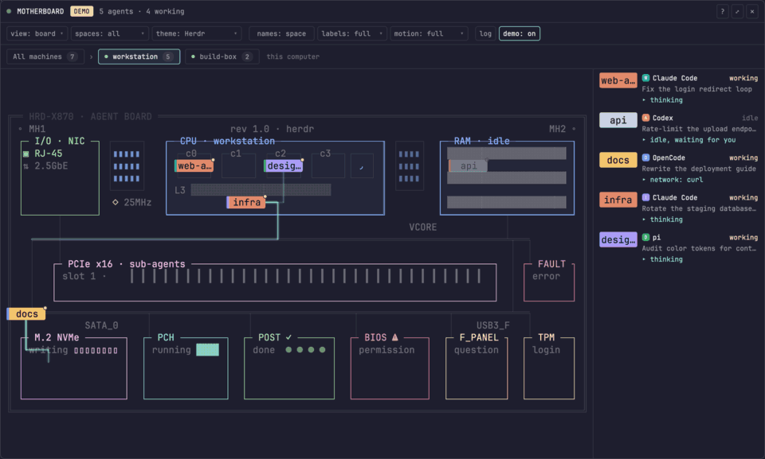
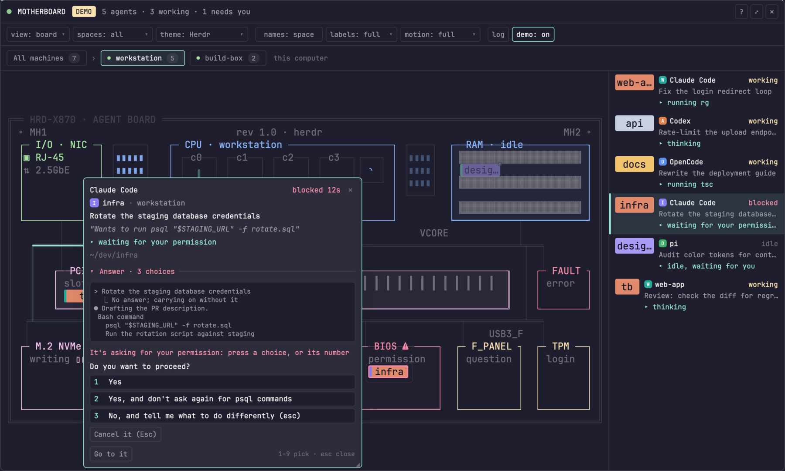
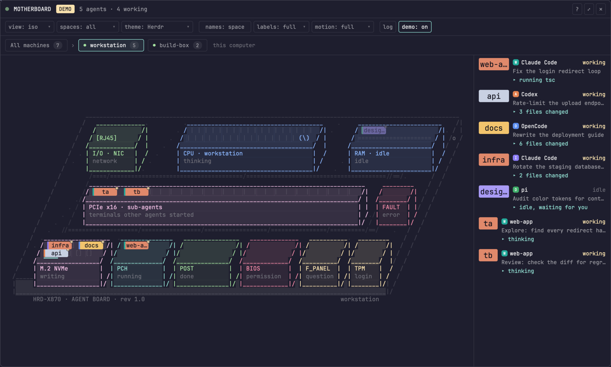
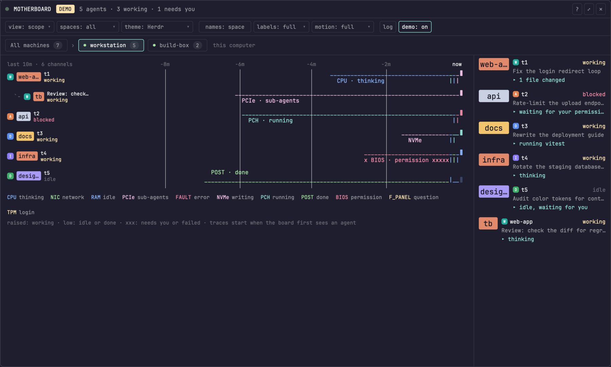
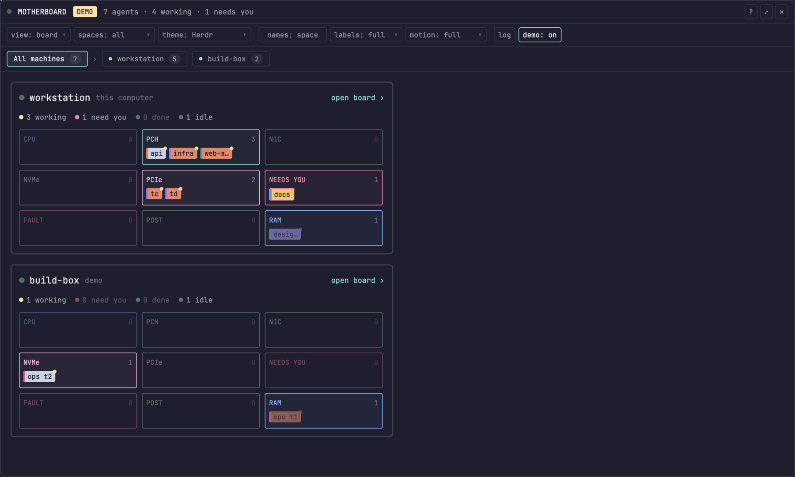
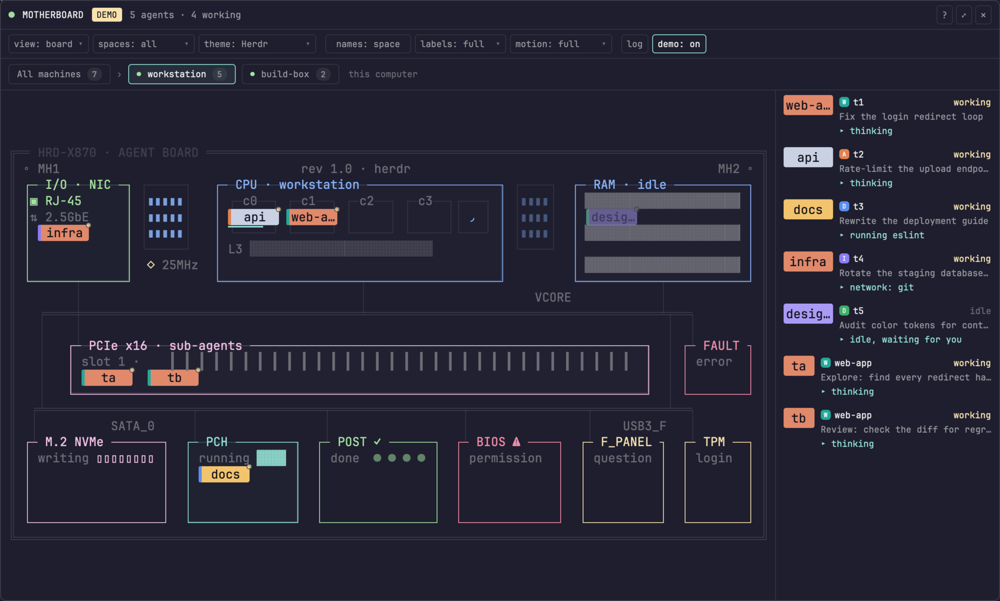
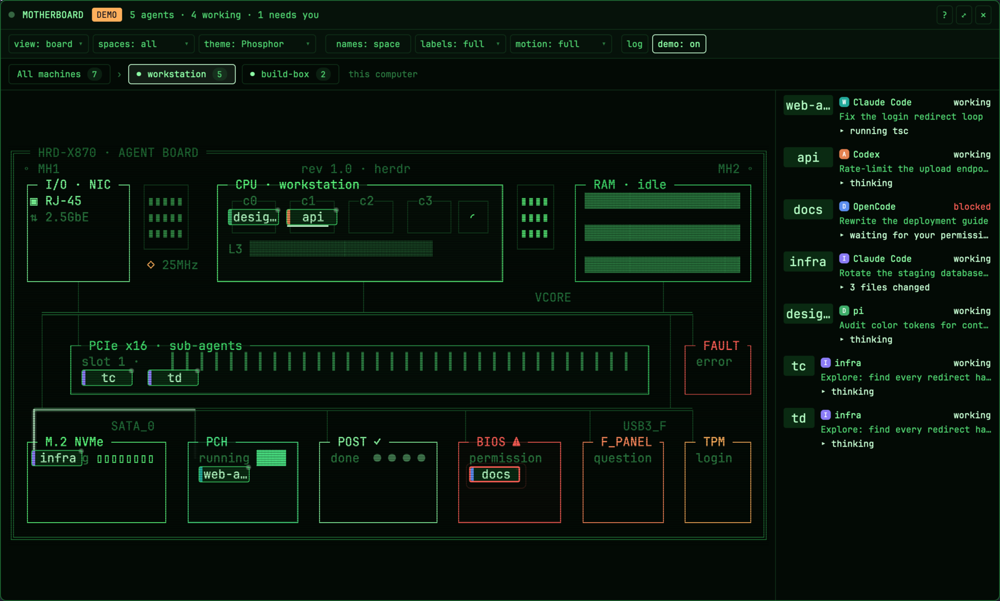
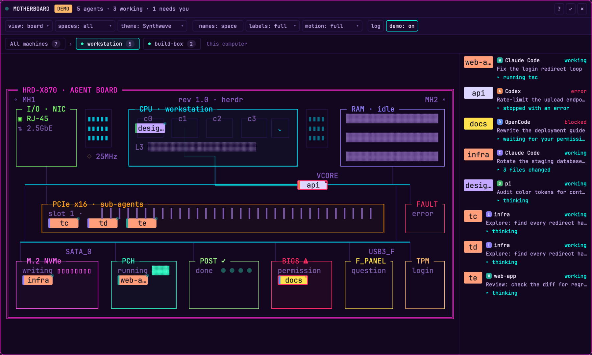
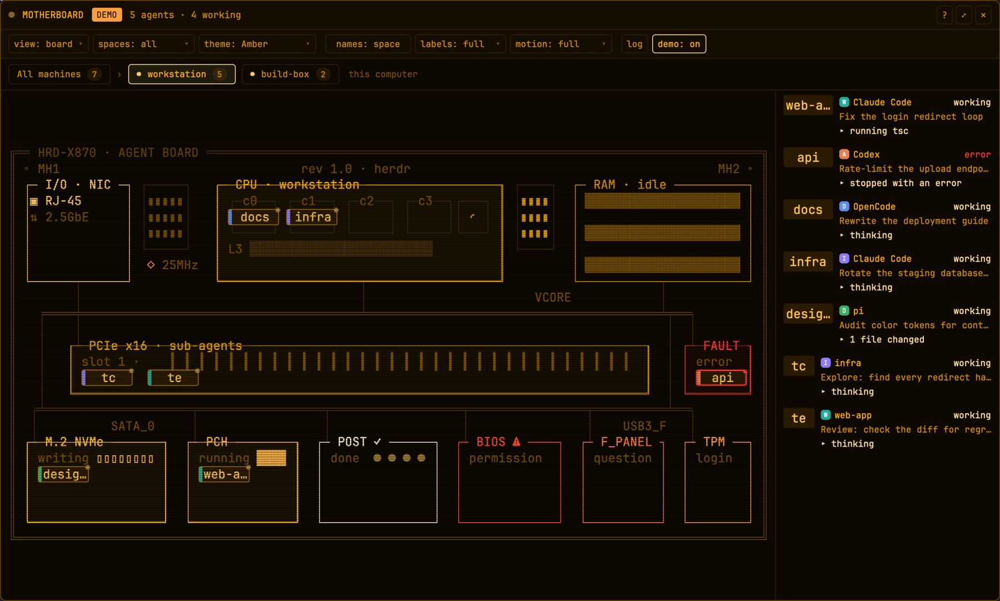
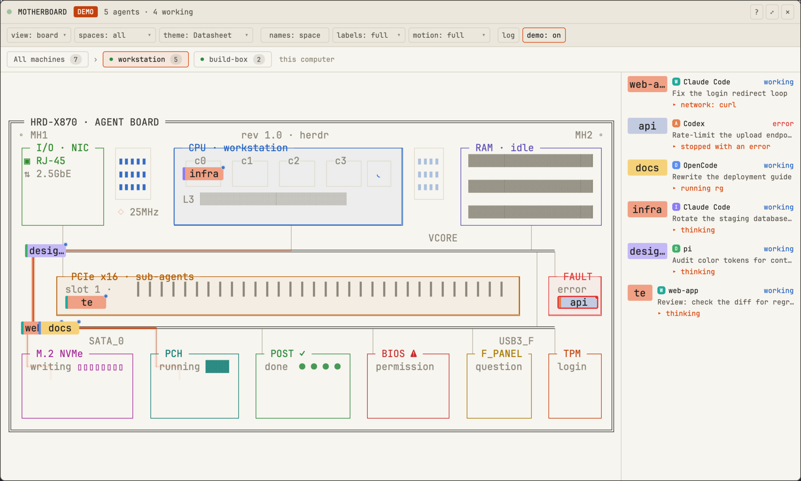

<h1 align="center">Motherboard</h1>

  <b>Watch your AI agents work, visualized on an ASCII motherboard.</b> 
  A mod for the <a href="https://herdr.dev">Herdr</a> app.

  
  
  
  

  

Every agent in Herdr (Claude Code, Codex, OpenCode, pi, anything that reports a status) becomes
a chip on the board. When an agent starts thinking, its chip travels the bus to the **CPU**. When
it runs a command, it moves to the **PCH**. When it needs your permission, it lands in the
**BIOS** and pulses until you answer. You can tell what a dozen agents are doing at a glance,
without opening a single tab.

- **See everything at once.** One board per machine, every agent on it, with what each is doing
  right now.
- **Answer without switching tabs.** Click a chip to read the bottom of the agent's screen, send
  it a message, or pick an answer to its question or permission prompt right on the card.
- **Works with any agent.** It reads Herdr's own status reports, refined by the agent's child
  processes and its repo's file changes. No hooks or setup per agent.
- **Four ways to look at it.** The flat board, a 3D ASCII board, a logic-analyzer timeline,
  and an overview of every machine you're connected to.
- **Seven themes**, or write your own in a few lines of JSON.

  

## Reading the board

| Component | The agent is… |
| --- | --- |
| **CPU** | thinking |
| **PCH** | running a command |
| **NIC** | running a network command (`curl`, `gh`, `git`, `ssh`, …) |
| **NVMe** | changing files in its repo |
| **PCIe** | running sub-agents (each gets its own chip in a slot) |
| **BIOS** | waiting for your permission |
| **F_PANEL** | asking you a question |
| **TPM** | waiting for a login |
| **FAULT** | stopped with an error |
| **POST** | done while you were away |
| **RAM** | idle |

Hover a chip for its card. Click it to keep the card open, then expand **Message agent** to see
the agent's screen and type to it. When it's blocked, its choices appear as buttons (or press
`1`–`9`). Double-click a chip to go to its terminal.

## Views

<table>
  <tr>
    <td width="50%"> <b>Iso</b>: the same board in 3D ASCII.</td>
    <td width="50%"> <b>Scope</b>: a logic-analyzer trace of where each agent has been.</td>
  </tr>
  <tr>
    <td width="50%"> <b>All machines</b>: one card per machine, over ssh too.</td>
    <td width="50%"> <b>Board</b>: name chips by space or address, with a list of every agent on the right.</td>
  </tr>
</table>

## Themes

<table>
  <tr>
    <td width="50%"> Phosphor</td>
    <td width="50%"> Synthwave</td>
  </tr>
  <tr>
    <td width="50%"> Amber</td>
    <td width="50%"> Datasheet (light)</td>
  </tr>
</table>

Also Herdr (the default), Blueprint and Solder Mask. **theme ▾ → Copy to a new theme** gives you
a JSON file to edit; changes show up as you save.
[`themes/README.md`](mods/herdr-motherboard/themes/README.md) lists every color role.

## Install

1. Copy `mods/herdr-motherboard/` into `~/.config/herdr-app/mods/`.
2. Merge [`keys.json`](keys.json) into `~/.config/herdr-app/keys.json`, or bind
   `mod.open:herdr-motherboard` to a key of your own.
3. Run `herdr-app check ~/.config/herdr-app/mods/herdr-motherboard` and look for `check passed`.

Or let an agent do it: point an agent working in Herdr at this repo and ask it to add the mod.
[RECIPE.md](RECIPE.md) is the full brief to build it from scratch.

## Keys

| Key | Does |
| --- | --- |
| `cmd-shift-m` / `ctrl-shift-m` | open or close the board as a window |
| `cmd-alt-m` / `alt-shift-m` | open it as a pane to the right |
| `v` · `l` · `m` | view, labels and motion menus |
| `n` · `c` · `t` | chip names, next theme, log |
| `a` · `f` · `s` | all machines, spaces menu, this space only |
| `←` `→` · `r` · Enter | select a chip, open its card, go to it |
| `1`–`9` | answer a blocked agent from its card |
| `d` · `?` · Esc | demo, legend, close |

## Try it

- **Demo:** click `demo` in the header for seven simulated agents across two machines.
- **A pretend agent:** run `node mods/herdr-motherboard/test/echo-agent.mjs` in a Herdr tab. It
  echoes what you send it. Send `ask` for a question or `allow` for a permission prompt, then
  answer from its card.

## What it runs

No network access of its own. It runs `ps` (PowerShell on Windows) to see agents' child
processes, and `git rev-parse` plus a folder watch on a working agent's repo to see file changes.
It runs `hc read` on an agent whose card is open. It types into an agent's terminal (`hc send`,
`hc keys`) only when you send a message or pick an answer in its card. The full list is under
"What it runs and reads" in [RECIPE.md](RECIPE.md).

## Development

`node --test mods/herdr-motherboard/test/*.test.mjs` (Node 22 or later).

Built and tested on Herdr 0.1.16 on macOS; the tests also pass on Linux. Windows support is
written and unit-tested but hasn't run on a real Windows machine yet.

## License

[MIT](LICENSE)
