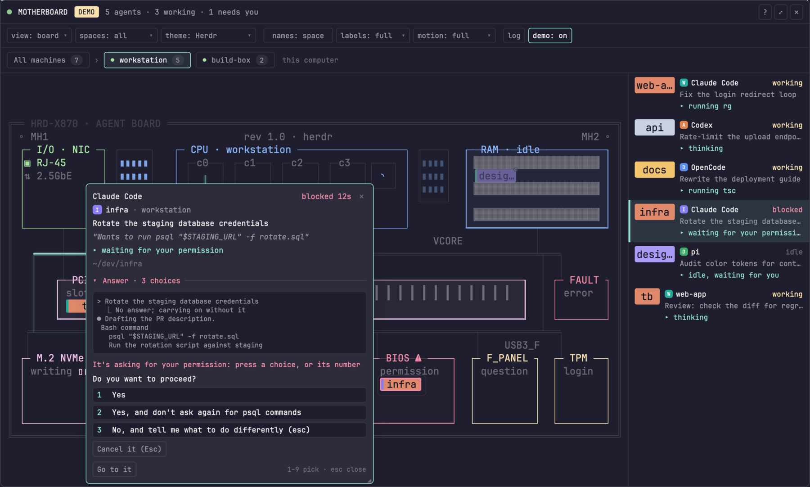

# herdr-motherboard

Every agent Herdr knows about (Claude Code, Codex, OpenCode, pi, anything that reports a
status) appears on an ASCII motherboard as a small labeled box. Agents travel along the data buses
to the component that matches what the agent is doing: the CPU while it thinks, the PCH
while it runs a command, the NIC for network commands, the NVMe while files change, BIOS
when it needs your permission. One board per machine, an overview of all machines, a 3D
ASCII view and a logic-analyzer timeline. Opens as a window or a pane, any time.

## What you see

Top to bottom, in JetBrains Mono:

- **Header** (`theme.chrome`), two rows:
  - a pulsing LED, `MOTHERBOARD`, a yellow `DEMO` badge while demo is on, and one line of
    counts ("5 agents · 3 working · 1 needs you", cut short when narrow); docked at the top
    right, always: `?` (legend), `⤢` (full size and back: a window fills Herdr's window, a
    pane zooms to fill its tab; `⤡` while it is) and `✕` (close the window or the pane);
  - the options, in three groups separated by 16 px: `view ▾`, `spaces ▾`, `theme ▾` |
    `names: space|address`, `labels ▾`, `motion ▾` | `log`, `demo`. Every button has a fixed
    width and is always there, so changing an option moves nothing; a narrow board wraps
    whole groups onto another line. Anything with more than two choices is a dropdown, drawn
    like a select box (label left, `▾` at the right edge); its menu opens pinned under its
    own button (`?`'s leftward from the right edge), and each choice has a one-line
    description.
- **Machines row:** `All machines` › one button per machine (a green `●` online, a red `○`
  unreachable), each 26 px tall with its agent count in a small rounded badge, then a note
  ("this computer", "live over ssh", "unreachable"). Wraps when narrow.
- **Body**, one of:
  - **All machines:** a card per machine (2 columns when the window is ≥ 1000 px wide):
    online dot, name, "open board ›", counts (working, need you, done, idle, error), and a
    3 × 3 grid of component cells (CPU, PCH, NIC / NVMe, PCIe, NEEDS YOU / FAULT, POST,
    RAM) holding up to 3 mini agents each, then "+N more". Click a card to open its board.
  - **board:** the flat motherboard, 104 × 25 cells, scaled to fit (6–16 px font; cell
    width 0.6 em, row height 1.32 em). Outlines are vector lines, 1 px, snapped to pixels;
    the board frame and both data buses are double lines. Components (x, y, w, h in cells):

    | Component | Box | Means |
    | --- | --- | --- |
    | I/O · NIC | 2, 2, 15, 7 | network command (curl, gh, git, ssh, npm, …) |
    | CPU · <machine> | 28, 2, 40, 7 | working, thinking (4 core slots c0–c3) |
    | RAM · idle | 77, 2, 25, 7 | idle |
    | PCIe x16 · sub-agents | 8, 12, 80, 4 | sub-agents (terminals another agent started) |
    | FAULT | 92, 12, 10, 4 | error |
    | M.2 NVMe | 2, 18, 20, 6 | files changing in its repo |
    | PCH | 24, 18, 16, 6 | running a command |
    | POST ✓ | 42, 18, 17, 6 | done |
    | BIOS ⚠ | 61, 18, 15, 6 | blocked: permission |
    | F_PANEL | 78, 18, 12, 6 | blocked: question |
    | TPM | 92, 18, 10, 6 | blocked: login |

    Bus 1 runs along row 10, bus 2 along row 16, joined by lanes at columns 4 and 90; each
    component has a pad trace to its bus. Decoration: VRM blocks that breathe, a 25 MHz
    crystal that blinks, a spinning fan glyph on the CPU (faster the more agents work),
    DIMM strips, PCIe fins, silkscreen (`HRD-X870 · AGENT BOARD`, `rev 1.0 · herdr`,
    `MH1`, `MH2`, `VCORE`, `SATA_0`, `USB3_F`).
  - **iso:** the same board in 3D, drawn only with ASCII (`_` across, `/` into the screen,
    `|` up) on a 133 × 26 grid. Components are raised blocks 3 rows tall with tinted top
    and front faces; the front face carries the name and, under it, what being there means
    ("running", "permission", "login"…). CPU fins and a `(|)` fan, RAM sticks, `[RJ45]`,
    NAND `[]`. Buses are `====` rows with `/` pads, each on a row of its own.
  - **scope:** a logic analyzer. A time axis (ticks every 10 s / 30 s / 2 min for 1 / 3 /
    10 minute spans, "now" at the right), then one channel per agent: space avatar, agent name,
    space name and status on the left; a two-row ASCII trace on the right, raised while
    working, low while idle or done, hatched `x` while it needs you. Each stretch is named
    where its row is empty ("CPU · thinking" inside a raised one, "RAM · idle" above a low
    one). Under the channels, every component in its color with its meaning.
- **Log bar** (toggle with `log`): the last 5 moves, "12:04:11 t3 → PCH  running vitest".

**Agents** are colored by program (Claude `#e0896b`, Codex `#c9d1e3`, OpenCode
`#f2c46d`, pi `#a99bf5`, Cursor `#8fd3c9`, Gemini `#8ab4f8`, Kiro `#b8e986`, Amp
`#f5a3c7`, others `#b4befe`) with dark text, a 3 px stripe on the left in the agent's
space color (the same color Herdr's sidebar gives the space), and a name. With `names:
space` (the default) an agent is 7 cells wide and shows its space's name, cut to fit, plus the
tab's number when another agent shares the space (`herdr 3`); with `names: address` it is 4
cells and shows the Herdr terminal address (`t3`, `t1y`). Sub-agents always show their
address. A status dot sits on the top-right
corner: working pulses, blocked blinks red, done green, idle grey.

## How it behaves

- **Placement** comes from Herdr's own agent state (the OSC 7501 report every agent
  integration sends): working → CPU, blocked → BIOS / F_PANEL / TPM by its `kind`
  (permission, question, auth), error → FAULT, done → POST, idle or no status → RAM. A
  terminal with a `parent` sits in PCIe. While an agent works, the board refines it from
  the machine: a new child process of the agent (started during this turn, not one that
  was there while it was idle) moves it to the PCH, or to the NIC when that process is a
  network command; files changing under its git repo move it to the NVMe for 4 s.
- **Movement:** when an agent's component changes (after it has sat 800 ms, except for the
  ones that need you), the agent walks the route: up or down its pad, along the bus, across
  a lane if it changes bus, to the new component's free slot, at 11 ms per column. The
  trace it walks lights up behind it and fades over 700 ms. `motion: reduced` slides
  straight there in 450 ms; `off` jumps.
- **Crowding:** each component has fixed slots. When it's full, the last slot or two show
  "+N more"; hover or click that for a scrolling list of everyone there.
- **Hover an agent** (board and iso, unless labels is `off`): its full card opens beside it,
  once the pointer moves onto the agent (an agent sliding under a resting pointer doesn't open
  one). It's for reading: it closes the moment the pointer leaves the agent. Click the agent to
  keep it open and use it. The card: the agent, its program,
  status and how long, space avatar and name, machine, title, last message, what it's doing,
  folder, progress, why it's in that component when the board saw something Herdr didn't
  report (a child process, file changes, a parent agent), then an arrow row, "▾ Message
  agent" (or "▾ Answer · 3 choices" in red when it's blocked), over the inline part: the
  bottom of its screen (`hc read`, every 1.2 s) and a box to message it. Collapsed by default;
  the arrow expands that one agent's card only (`expanded` in settings, forgotten when the
  agent ends). `short` prints space and activity under each agent; `full` adds a rail of every
  agent on the right. Each row's badge reads like that agent on the board (`names`: space or address), and
  the line beside it gives the other. Rows tint (`theme.lit` at low alpha) under the pointer to show they're
  clickable, and the agent whose card is open has a stronger tint and a 3 px `theme.lit` bar
  on its left.
- **Click an agent** (or a rail row, a scope channel, an overview mini agent; `r` for the
  selected one) keeps its card open after the pointer leaves (pinned; in the scope and the
  overview, this is the only way to get one, top right). Enter sends (`hc send`: pasted, then
  Enter), the box clears and a note says "Sent" or why not. A blocked agent shows its
  prompt instead: the question, and each numbered choice its screen offers as a button
  (or press 1–9); picking one presses that number in its terminal, as Claude Code's
  permission and question menus expect. Before pressing, the card rereads the screen and
  refuses if the menu changed. Picked, the choice lights up and the rest stop taking clicks;
  once pressed, the menu is hidden at once ("Answered. Waiting for it to go on…") and the
  screen is read again right away, and that same menu isn't offered again for 4 s while the
  agent redraws. A "Type something." choice opens the box: Enter presses its
  number, then pastes the answer. "Cancel it (Esc)" presses Esc there. With no menu on its
  screen, the box sends text anyway (`--force`). The screen box then shows what's above the
  question (the command or diff being asked about). Demo agents get no box. The card stays
  put while the agent moves, and pressing the agent pins it where it is; drag its header to
  move it (that pins it too; double-click the header to put it back beside the agent). Every
  card opens beside its agent. Drag its corner to resize it (min 340 × 260, remembered); ✕, Esc or a press outside closes it.
  There's no peek: the card covers it. Occupied
  components glow and pulse (fast for the ones that need you).
- **Spaces menu:** All / None / This space, then each space with a checkbox, its avatar,
  machine and agent count. Chosen rows are tinted and bold; others are dimmed. With none
  chosen, the board says so and offers "Show all".
- **Menus** close on any press outside them, including elsewhere in Herdr; picking a theme or
  a view closes its menu. The view menu also holds the scope's span (1 / 3 / 10 minutes).
- **Size:** a pane resizes by dragging its edge and zooms with `⤢`, like any pane. A window
  resizes by dragging its right edge, bottom edge or bottom-right corner (resize cursors
  show there; min 560 × 360 px), and remembers its size; `⤢` makes it fill Herdr's window
  and `⤡` brings it back.
- **Demo** (going to a demo agent shows a toast saying it needs a real terminal;
  clicking the toast turns demo off) swaps in 7 simulated agents (5 on this computer, 2 on the other machine, plus
  sub-agents) cycling through every state. Demo machines have made-up names
  (`workstation`, `build-box`), so a screenshot shows none of the person's. Live data is untouched and returns when off.
- **Keys** (pressing any control, or opening the window, gives the board the keyboard): `v`
  view menu, `l` labels menu, `m` motion menu, `n` names, `z` size, `a` / Backspace all
  machines, `d` demo, `c` next theme, `t` log, `f` spaces menu, `s` this
  space only, `← →` select an agent, `r` message it, Enter focus it, `1`–`9` pick a blocked agent's choice (card
  expanded), `?` legend, Esc: close a menu, else the card, else the window. While typing in a card's
  box, every key is the box's except Esc.
- **Global keys** (`keys.json`): `cmd-shift-m` / `ctrl-shift-m` toggles the window,
  `cmd-alt-m` / `alt-shift-m` opens it as a pane to the right.

## Built from

- `mod.json`: `place: "none"`, `focusable: true`, overlay `{ kind: "window", key:
  "herdr-motherboard", keep: true, frame: "none" }`: no width or height, so the window is as
  big as the board makes itself (`winW` × `winH` in settings, 1240 × 760 to start), and no
  frame, so the board draws its own 1px rounded border.
- `main.js` (the view), `board.js` (geometry, slots, routes, timing), `model.js` (placement
  rules, process parsing), `iso.js`, `scope.js`, `demo.js`, `themes.js`, `platform.js`
  (per-OS commands), `themes/*.json`, `test/` (`node --test test/*.test.mjs`).
- `herdr`: `agents()`, `terminals()` (`report`, `parent`, `foreground.pid`, `status_ms`),
  `machines()`, `spaces()`, `panes()`, `focused()`, `theme()`, `themes()`, `shared()` /
  `setShared()` (settings under `herdr-motherboard.settings`; space colors from the
  sidebar's `space.colors`), `exec()`, `watchFolder()`, `writeTextFile()`, `nextCommand()`,
  `openOverlay` / `closeOverlay`, `run("agent.focus" | "pane.close")`,
  `hc(["read" | "send" | "keys", "--json", "--", address, ...])` for the card.
- gpui-base `InputState` / `Input` for the message box.
- gpui-base `Popup` for every menu (anchored to its button, painted above everything);
  gpui-kit: `window.paint_path` for lines, native `transition` / `loop` / `frames` for all
  motion (the script re-renders only on data changes and at route corners),
  `on_mouse_down_out` for menus, `on_mouse_move` / `on_mouse_up` and `cursor_*_resize` for
  window edges, `notify` for the demo toast.
- Mod commands (`herdr-motherboard.<name>`): `demo`, `all`, `local`, `board`, `iso`,
  `scope`, `spaces`, `themes`, `legend`, `next-theme`, `no-spaces`, `all-spaces`, `close`,
  `grow`, `full`, `size-<w>x<h>` (e.g. `size-1400x800`), `menu-<name>` (opens a menu: view,
  spaces, themes, labels, motion, legend).
- **What it runs and reads** (tell the person before installing):
  - every 2 s while an agent works (every 10 s otherwise), a process list of this computer:
    `ps -A -o pid=,ppid=,etime=,comm=` on macOS and Linux, a PowerShell
    `Get-CimInstance Win32_Process` query on Windows (half as often);
  - the same on other machines Herdr is connected to, through herdr-core: every 6 s while
    an agent there works, every 30 s otherwise; it tries `ps`, then PowerShell, and keeps
    whichever answers (a failure waits 30 s);
  - `git rev-parse --show-toplevel` in a working agent's folder, then `watchFolder` on that
    repo (never on a home folder; `.git`, `node_modules`, build output ignored);
  - `hc read` of an agent's screen every 1.2 s while its card is open; `hc send` and
    `hc keys` type into that agent's terminal, but only when you send a message or pick an
    answer in its card;
  - Herdr's own `windows.json`, for where its window was;
  - `scutil` (macOS), `hostnamectl` or `hostname` for the computer's name;
  - `open` / `xdg-open` / `explorer` / `notepad` only when you pick "Open themes folder" or
    "Copy to a new theme".
  - No network access of its own. If a command is missing, it places agents by Herdr state.
- **Themes:** each `themes/*.json` is a theme (`herdr`, `phosphor`, `amber`, `blueprint`,
  `solder-mask`, `synthwave`, `datasheet` ship). Values are hex or Herdr color names; a theme
  can `extends` another or borrow a Herdr theme with `herdrTheme`. `themes/README.md` lists
  all 31 roles. Edits apply on save.

## Watch out

- GPUI elements are single-use: cache built `Path`s, never elements, across renders.
- `line_height(n)` with a number is a multiplier; pass `"${px}px"` or text drifts off the grid.
- `.bg(null)` throws during render; use `.when(cond, e => e.bg(...))`. `herdr-app check`
  doesn't run `render`, so look at a screenshot after changes.
- `overflow_y_scrollbar()` drops `absolute()` positioning and collapses without a definite
  height: put floating scroll lists inside a plain positioned box with a height.
- The keyboard: a window doesn't take it when it opens, controls that stop the press never
  reach the root. So the board focuses itself on open and on every control press; without
  that, Esc does nothing.
- Resizing a window: Herdr has no resize for mod windows, and a mod only hears the pointer
  while it's over the mod. So the window is content-sized and frameless; the edges carry
  handles, and while one is dragged the board grows an invisible 2400 px catch area past its
  edges so the pointer stays over it, then drops it on release. The top and left edges can't
  resize: a mod can't move its window's top left.
- Windows: reopening the same key replaces the window *in its spot* (a new `at` is ignored),
  and a copy that closes its own window can't open another afterwards. So Full opens a
  second, keyless window at the top left first, then closes the old one; going back opens
  the keyed window first, then closes the full one.
- Box-drawing glyphs don't line up across fonts; the flat board's lines are vector paths and
  iso shades only straight-sided faces (slanted fills stair-step on a character grid).
- Mod command names can't contain `:`; use dashes.
- Herdr's peek was dropped: a bare `run("overlay.close")` closes whatever is on top (which can be
  the board's own window), and no API says whether a peek is still open.
- Dragging the card: the board root takes `on_mouse_move` / `on_mouse_up` while a drag is on,
  rather than a catch layer over the board. A layer whose release got lost (let go outside
  the board) sat over the card and swallowed the next click; without one, the next press just
  ends the drag.
- Elements under the card still get hover and pointer-move events (nothing blocks them), so a
  agent under the card ignores the pointer while `cardHover` is set; otherwise it takes the card
  over.
- A pressed element doesn't count as hovered (`on_hover(false)` fires on the press), so a
  agent pins its card on mouse down; waiting for the click let the hover card close first.
- Answering prompts: in Claude Code a choice's number picks it at once; "Type something."
  opens a field that a `hc send --force` then fills and submits (checked on Claude Code
  2.1.325). `hc keys <t> <n>` presses the number, `hc keys <t> esc` cancels.
- Messaging: `hc send` refuses a blocked agent (exit 9, `{"error":{"kind":"blocked"}}`) unless
  `--force`, and takes a second or two to answer; its `started: false` means no turn began
  (a typed answer starts none), not that nothing was typed. Pass `--` before the address so
  text starting with `-` isn't read as a flag. Sent from a terminal, the text arrives wrapped
  in `<hc from="t3">…</hc>`; sent from the board, it arrives as typed.
- The root's `on_key_down` also hears keys typed into the message box (the box is inside it),
  so `key()` ignores everything but Esc while the box has focus; the card stops presses so the
  root doesn't take the keyboard back from the box.
- `test/echo-agent.mjs` is a pretend agent for trying the card: run it in a Herdr tab, send it
  text, "ask" (question) or "allow" (permission); both draw numbered menus taken by one key,
  like Claude Code's. It reports through OSC 7501:
  `ESC ] 7501 ; state=idle:app=echo-agent:msg=<base64> BEL`. Fields are joined by `:`, and
  `msg` must be base64; a plain `msg` makes Herdr drop the whole report.
- The folder name is in one constant, `MOD` in `main.js` (theme folder, settings key). If you
  install it under another name, change that and the names in `keys.json`.
- Agents that never report a status to Herdr don't appear (a terminal running an agent
  program with no report shows in RAM).
- Trails, glows and agent motion are native animations; a hidden copy (a pane in another tab)
  keeps polling processes.

## Done when

- `herdr-app check herdr-motherboard` passes and `node --test test/*.test.mjs` passes (33, on macOS and Linux).
- `cmd-shift-m` opens the window with no entry in `herdr-app status` errors; `✕` and Esc
  close it.
- An agent that starts working moves RAM → CPU along the bus with a lit trail; when it runs
  `sleep 5` it moves to the PCH and the log says "running sleep".
- Demo shows 7 agents across two machines, sub-agents in PCIe, and a blocked agent pulsing
  in BIOS; All machines shows one card per machine and each card opens its board.
- Clicking the echo agent pins its card with its screen; typing "hi" and Enter makes it
  answer "you said "hi"" on that screen; "allow" blocks it and the card lists Yes / Yes, and
  don't ask again / No as buttons, and pressing 1 makes it say "you picked 1. Yes"; "ask"
  then 4 ("Type something.") and "Purple" makes it say "you answered "Purple"".
- `iso` and `scope` render the same agents; hovering a scope stretch shows its component,
  duration and times.
- Saving a new `themes/*.json` adds it to the theme menu without a reload; a broken one is
  listed there with the reason.
